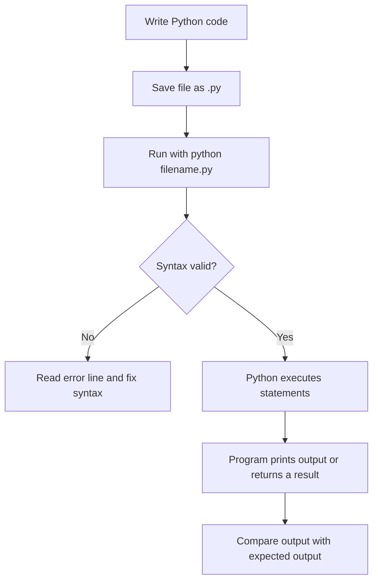
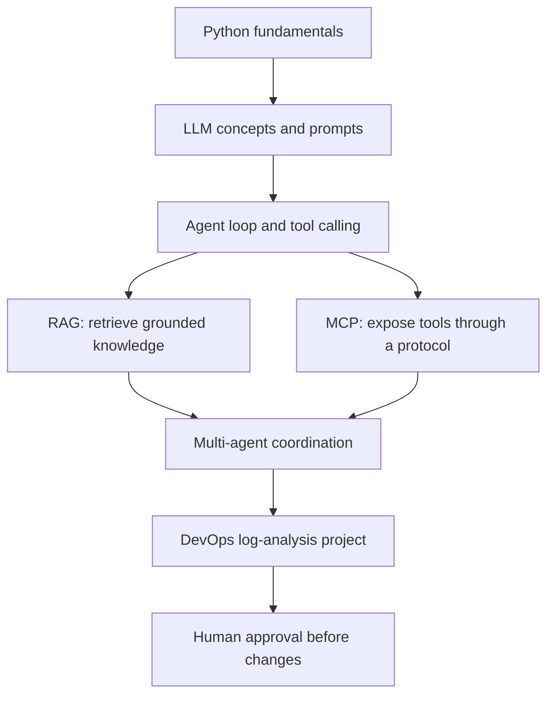

# Core Python Curriculum — Beginner to DevOps-Ready

This is the main Python learning guide for this repository. It assumes no previous Python experience. Read a concept, type the examples yourself, compare the output, and then complete the exercise. The examples use small DevOps situations so the concepts become useful for later AI-agent projects.

> **How to study:** Do not only copy and paste. Predict the output first, run the code, explain why each line behaves as it does, then change one input.

## 0. How Python code runs

Python executes a script from top to bottom, except when control flow (such as a function call, condition, or loop) changes what runs.



Example:

```python
print("Starting log analysis")
print("Checking Jenkins")
```

Expected output:

```text
Starting log analysis
Checking Jenkins
```

## 1. Variables and basic data types

A variable is a name that refers to a value. Python figures out the value's type at runtime.

### Example 1 — strings, integers, and booleans

```python
service = "jenkins"
retry_count = 3
pipeline_failed = True

print(service)
print(retry_count)
print(pipeline_failed)
print(type(retry_count).__name__)
```

Output:

```text
jenkins
3
True
int
```

Explanation: `=` assigns values. Quotation marks create a string, `3` is an integer, and `True` is a boolean. `type(...).__name__` displays the type's short name.

### Example 2 — changing a value

```python
retry_count = 2
print("Before:", retry_count)
retry_count = retry_count + 1
print("After:", retry_count)
```

Output:

```text
Before: 2
After: 3
```

The right side is evaluated first, then the result is assigned to `retry_count`.

**Try it:** Add a float variable named `latency_seconds = 1.75` and print its type.

## 2. Operators and comparisons

Operators calculate values or compare them. Comparisons return `True` or `False`.

### Example 1 — arithmetic

```python
failed_jobs = 2
retried_jobs = 3
print(failed_jobs + retried_jobs)
print(retried_jobs * 10)
```

Output: `5` then `30`, each on its own line.

### Example 2 — comparisons and logic

```python
latency_ms = 850
server_healthy = True
print(latency_ms > 500)
print(latency_ms > 500 and server_healthy)
print(not server_healthy)
```

Output:

```text
True
True
False
```

`>` compares numbers, `and` requires both conditions to be true, and `not` reverses a boolean.

## 3. Strings and string methods

Strings hold text. Methods such as `lower()`, `strip()`, and `replace()` return transformed strings.

### Example 1 — normalize log text

```python
log_line = "  ERROR: Connection TIMEOUT  "
normalized = log_line.strip().lower()
print(normalized)
print("timeout" in normalized)
```

Output:

```text
error: connection timeout
True
```

### Example 2 — f-strings

```python
service = "payments-api"
status_code = 503
print(f"Service {service} returned HTTP {status_code}")
```

Output: `Service payments-api returned HTTP 503`

An f-string inserts the value of an expression inside braces.

**Try it:** Convert `"DISK FULL"` to lowercase and check whether it contains `"disk"`.

## 4. Lists

A list stores an ordered, changeable collection. Indexes start at zero.

### Example 1 — read list values

```python
services = ["jenkins", "docker", "kubernetes"]
print(services[0])
print(services[-1])
print(len(services))
```

Output:

```text
jenkins
kubernetes
3
```

### Example 2 — add and remove values

```python
failed_jobs = ["build", "test"]
failed_jobs.append("deploy")
print(failed_jobs)
failed_jobs.remove("test")
print(failed_jobs)
```

Output:

```text
['build', 'test', 'deploy']
['build', 'deploy']
```

Use a list when order matters or you need to add/remove items.

## 5. Tuples and sets

A tuple is an ordered collection that cannot be changed after creation. A set stores unique values and is useful for removing duplicates.

### Example 1 — tuple

```python
coordinates = (17.4, 78.4)
print(coordinates[0])
print(len(coordinates))
```

Output:

```text
17.4
2
```

### Example 2 — set removes duplicates

```python
error_types = {"timeout", "disk_full", "timeout"}
print(len(error_types))
print("timeout" in error_types)
```

Output:

```text
2
True
```

Set display order is not guaranteed; do not depend on its printed order.

## 6. Dictionaries

A dictionary stores key-value pairs. Use it when a value has a meaningful label, such as a service name or incident status.

### Example 1 — access values

```python
incident = {"service": "jenkins", "status": "failed"}
print(incident["service"])
print(incident.get("owner", "unassigned"))
```

Output:

```text
jenkins
unassigned
```

Square brackets raise `KeyError` if the key is missing. `get()` lets you provide a fallback.

### Example 2 — update a record

```python
incident = {"service": "payments-api", "status": "failed"}
incident["status"] = "investigating"
incident["severity"] = "high"
print(incident)
```

Output:

```text
{'service': 'payments-api', 'status': 'investigating', 'severity': 'high'}
```

**Try it:** Create a dictionary with `error_type`, `count`, and `owner`.

## 7. Conditions: if, elif, else

Conditions choose which block should run. Python checks branches from top to bottom and runs the first matching branch.

### Example 1 — classify an error

```python
log_line = "Jenkins connection timeout".lower()
if "timeout" in log_line:
    print("Check network latency and server health")
elif "permission denied" in log_line:
    print("Check service account permissions")
else:
    print("Collect more evidence")
```

Output: `Check network latency and server health`

### Example 2 — severity threshold

```python
failed_checks = 4
if failed_checks >= 5:
    severity = "high"
elif failed_checks >= 2:
    severity = "medium"
else:
    severity = "low"
print(severity)
```

Output: `medium`

Indentation defines which statements belong to each branch. Consistent four-space indentation is standard.

## 8. Loops: for and while

Loops repeat work. Use `for` to process each item in a collection. Use `while` when repetition depends on a condition.

### Example 1 — process every log

```python
logs = ["timeout", "disk full", "permission denied"]
for log in logs:
    print("Investigating:", log)
```

Output:

```text
Investigating: timeout
Investigating: disk full
Investigating: permission denied
```

### Example 2 — bounded retry counter

```python
attempt = 1
while attempt <= 3:
    print("Attempt", attempt)
    attempt += 1
```

Output:

```text
Attempt 1
Attempt 2
Attempt 3
```

The `attempt += 1` line prevents an infinite loop. Real retry logic should also use timeouts, backoff, and clear stopping conditions.

## 9. Functions, parameters, and return

A function packages reusable logic. Parameters receive inputs. `return` sends a result back to the caller; `print` only displays text.

### Example 1 — classify a log

```python
def classify_log(log_line):
    text = log_line.lower()
    if "timeout" in text:
        return "TIMEOUT"
    return "UNKNOWN"

print(classify_log("API connection timeout"))
print(classify_log("unexpected response"))
```

Output:

```text
TIMEOUT
UNKNOWN
```

### Example 2 — default parameter

```python
def retry_message(service, attempts=3):
    return f"Retry {service} up to {attempts} times"

print(retry_message("jenkins"))
print(retry_message("payments-api", 5))
```

Output:

```text
Retry jenkins up to 3 times
Retry payments-api up to 5 times
```

**Try it:** Add a `"DISK_FULL"` classification before the fallback.

## 10. List comprehensions

A list comprehension creates a list from an iterable, optionally filtering items. It is a compact alternative to a simple loop.

### Example 1 — normalize names

```python
services = ["Jenkins", "Docker", "Kubernetes"]
normalized = [service.lower() for service in services]
print(normalized)
```

Output: `['jenkins', 'docker', 'kubernetes']`

### Example 2 — filter failed jobs

```python
statuses = ["passed", "failed", "failed", "passed"]
failures = [status for status in statuses if status == "failed"]
print(len(failures))
```

Output: `2`

Use a regular loop when the comprehension becomes hard to read.

## 11. Modules and imports

A module is a Python file that can be imported by another file. Imports let you reuse standard-library or project code instead of rewriting it.

### Example 1 — standard library

```python
from pathlib import Path
print(Path("logs") / "jenkins.log")
```

Output on Windows may show backslashes; on Linux it usually shows forward slashes. The path object joins path components safely for the current operating system.

### Example 2 — create a reusable module

Create `helpers.py`:

```python
def normalize(text):
    return text.strip().lower()
```

Create `main.py` in the same folder:

```python
from helpers import normalize
print(normalize("  TIMEOUT  "))
```

Output: `timeout`

Run `python main.py` from that folder. Python can import `helpers.py` because it is in the same directory.

## 12. File handling and pathlib

Files let programs read logs and write reports. Use context managers (`with`) so files are closed even if an error occurs. Use `pathlib` to work with paths.

### Example 1 — read a file

Create `sample.log` with this line: `ERROR connection timeout`.

```python
from pathlib import Path

path = Path("sample.log")
with path.open("r", encoding="utf-8") as file:
    content = file.read()
print(content.strip())
```

Output: `ERROR connection timeout`

### Example 2 — write a report

```python
from pathlib import Path

report = Path("report.txt")
report.write_text("Incident: TIMEOUT\nStatus: INVESTIGATING\n", encoding="utf-8")
print("Report written:", report.exists())
```

Output: `Report written: True`

The report is created in the current working directory. Do not write secrets or sensitive production log contents to an unapproved location.

## 13. Exceptions and defensive programming

An exception represents an error during execution. Catch specific exceptions you can handle; avoid silently swallowing every error.

### Example 1 — missing file

```python
from pathlib import Path

try:
    content = Path("missing.log").read_text(encoding="utf-8")
except FileNotFoundError:
    print("Log file not found; check the path")
```

Output: `Log file not found; check the path`

### Example 2 — validate numeric input

```python
raw_value = "not-a-number"
try:
    retries = int(raw_value)
except ValueError:
    print("Retry count must be an integer")
else:
    print("Retries:", retries)
```

Output: `Retry count must be an integer`

**Try it:** Handle an empty log path separately from a missing file.

## 14. Classes and objects

A class defines a kind of object and its behavior. An object is an instance of a class. Classes are useful when data and related behavior belong together; simple functions and dictionaries are often enough for small tasks.

### Example 1 — represent an incident

```python
class Incident:
    def __init__(self, service, error_type):
        self.service = service
        self.error_type = error_type

    def summary(self):
        return f"{self.service}: {self.error_type}"

incident = Incident("jenkins", "TIMEOUT")
print(incident.summary())
```

Output: `jenkins: TIMEOUT`

`self` refers to the current object. `__init__` initializes each new instance.

### Example 2 — add a method

```python
class Incident:
    def __init__(self, severity):
        self.severity = severity

    def needs_attention(self):
        return self.severity in ("high", "critical")

print(Incident("high").needs_attention())
print(Incident("low").needs_attention())
```

Output:

```text
True
False
```

## 15. JSON: exchange structured data

JSON is a common format for APIs, configuration, and incident reports. Python's `json` module converts between JSON text and Python objects.

### Example 1 — dictionary to JSON

```python
import json
incident = {"service": "jenkins", "severity": "high"}
json_text = json.dumps(incident, sort_keys=True)
print(json_text)
```

Output: `{"service": "jenkins", "severity": "high"}`

### Example 2 — JSON to dictionary

```python
import json
payload = '{"status": "failed", "attempt": 2}'
data = json.loads(payload)
print(data["status"])
print(data["attempt"])
```

Output:

```text
failed
2
```

Handle `json.JSONDecodeError` when parsing untrusted or malformed JSON.

## 16. Testing with assert and unittest

Tests check that code behaves as expected. Small tests help prevent a change for one error type from breaking another.

### Example 1 — simple assert

```python
def add(a, b):
    return a + b

assert add(2, 3) == 5
print("Basic check passed")
```

Output: `Basic check passed`

If the condition is false, Python raises `AssertionError`. Do not use `assert` as the only validation for security-critical inputs.

### Example 2 — unittest

```python
import unittest

def classify(text):
    return "TIMEOUT" if "timeout" in text.lower() else "UNKNOWN"

class ClassifyTests(unittest.TestCase):
    def test_timeout(self):
        self.assertEqual(classify("API TIMEOUT"), "TIMEOUT")

    def test_unknown(self):
        self.assertEqual(classify("other error"), "UNKNOWN")

if __name__ == "__main__":
    unittest.main()
```

Run `python test_example.py -v`. Expected summary: two tests run and `OK` (the exact elapsed time varies).

From repository root, run the project's tests:

```powershell
python -m unittest discover -s .\07-devops-ai-project\tests -v
```

## 17. Type hints and docstrings

Type hints document the expected kinds of values and help editors and static-analysis tools. Python does not automatically enforce ordinary type hints at runtime. A docstring explains what a function does.

### Example 1 — annotate a function

```python
def retry_delay(attempt: int) -> int:
    """Return a simple delay in seconds for an attempt number."""
    return max(1, attempt * 2)

print(retry_delay(3))
```

Output: `6`

### Example 2 — optional value

```python
def owner_label(owner: str | None) -> str:
    if owner is None:
        return "unassigned"
    return owner

print(owner_label(None))
print(owner_label("platform-team"))
```

Output:

```text
unassigned
platform-team
```

The `str | None` syntax requires Python 3.10 or newer.

## 18. Environment variables and secret hygiene

Environment variables can configure programs without hardcoding environment-specific values. Never print secrets or commit them to Git.

### Example 1 — optional environment setting

```python
import os
environment = os.getenv("APP_ENV", "development")
print(environment)
```

If `APP_ENV` is not set, output is `development`.

### Example 2 — check presence without displaying a secret

```python
import os
token_is_configured = bool(os.getenv("API_TOKEN"))
print("API token configured:", token_is_configured)
```

If `API_TOKEN` is not set, output is `API token configured: False`. The token itself is never printed.

## 19. Suggested practice sequence

1. Change each example's input and predict the output before running it.
2. Add `PERMISSION_DENIED` and `DISK_FULL` to the log classifier.
3. Read a log file line by line and count each category.
4. Save a JSON incident report.
5. Add tests for empty input, unknown input, and mixed-case text.
6. Explain why a rule-based classifier is not yet an LLM agent.
7. Add a proposed remediation field, but do not execute the remediation automatically.

## 20. Python-to-Agentic-AI connection



Python supplies the programming foundation. An LLM adds language-based reasoning, tools let an agent interact with systems, RAG supplies relevant knowledge, MCP standardizes tool connections, and orchestration coordinates specialists. These are separate concepts; adding a Python function alone does not make a system an LLM agent.

## Interview checkpoint

Be able to answer these in your own words:

- What is the difference between a list, tuple, set, and dictionary?
- What is the difference between `print` and `return`?
- Why should a file be opened with `with`?
- What is the difference between a syntax error and an exception?
- Why do we write unit tests?
- What are environment variables used for?
- How do Python functions become tools for an AI agent?
- Why should an agent propose a remediation and request approval instead of directly changing production?
