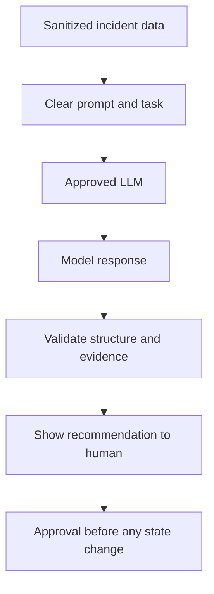

# 02 — LLM Fundamentals

## Learning goals
Understand LLMs, prompts, context limits, hallucinations, and output validation before using models in DevOps.

## What is an LLM?
A large language model generates text from learned patterns and current context. It does not automatically know your live infrastructure and can produce plausible but incorrect answers.

## Build a prompt

```python
def build_prompt(logs):
    return f"""You are a cautious DevOps assistant.
Analyze the sanitized log. Return observed evidence, likely causes,
safe read-only checks, and uncertainty. Do not execute commands.
LOG:
{logs}
"""

print(build_prompt("Jenkins: connection timeout"))
```
Output starts with `You are a cautious DevOps assistant.` and includes the supplied log. This only prints a prompt; it does not call a model.

## Prompt patterns
- Weak: "Fix this."
- Better: "Analyze this sanitized Jenkins timeout. Separate evidence from hypotheses, list safe read-only checks, and do not change systems."
- For structured output, request fields such as `summary`, `evidence`, `checks`, and `confidence`, then validate the schema in code.

## Tokens, context, and hallucinations
Long logs may exceed model context limits. Filter or retrieve relevant sections carefully. A hallucination is a claim not supported by evidence. Ask the model to distinguish facts from hypotheses.

## Safe integration
1. Redact secrets and personal data.
2. Send only necessary context to an approved model.
3. Validate returned structure and allowed actions.
4. Show recommendations to the user.
5. Require approval before state-changing operations.

## Exercises
1. Write a prompt for Kubernetes CrashLoopBackOff.
2. Request evidence separately from hypotheses.
3. Design a JSON schema for recommendations.
4. List cases where the model should say it does not know.

## Interview questions
What is an LLM? What are tokens and context windows? How can hallucinations be mitigated? Why validate model output? What sensitive data should be removed from logs?

## Additional example: prompt patterns

Run from the repository root:

```powershell
python .\02-llm-fundamentals\prompt_patterns.py
```

Linux:

```bash
python ./02-llm-fundamentals/prompt_patterns.py
```

The output prints two prompts: one for summarizing an incident and one requesting a structured JSON response. The script does **not** call an LLM API. Its purpose is to help you inspect and compare prompt wording before connecting an approved model.

[Open the example code](prompt_patterns.py).

## Visual: a safe LLM request

A prompt is only the request. Real integrations must also sanitize inputs and validate model output.


