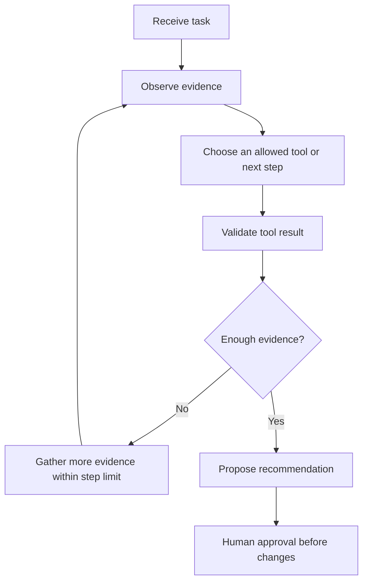

# 03 — Build Your First DevOps Agent


## What is an agent?
An AI agent typically combines a goal, model-driven reasoning, state/context, and tools that observe or act on an environment. A fixed `if/elif` script is useful groundwork but is not by itself a full LLM-powered agent.

## 1. Deterministic workflow
The existing `devops_agent.py` classifies logs and prints recommendations. It does not call an LLM or change infrastructure.

## 2. Agent loop concept
Receive task → inspect evidence → choose an allowed tool → validate result → update state → stop or ask for help. Add step limits and timeouts to prevent runaway loops.

## 3. Safe local tool example
```python
def inspect_log(logs):
    return {"contains_timeout": "timeout" in logs.lower()}

print(inspect_log("Jenkins connection timeout"))
```
Output: `{'contains_timeout': True}`. This is a local function, not a model tool call by itself.

## 4. Human approval example
```python
def propose_action(action, approved):
    if not approved:
        return f"Approval required before: {action}"
    return f"Approved for execution: {action}"

print(propose_action("restart staging service", False))
```
Output: `Approval required before: restart staging service`.

A production approval must bind to the exact action, target, parameters, approver, and time. A printed message alone is not a security control.

## Design rules
- Start with read-only tools and allowlists.
- Never expose unrestricted shell access to a model.
- Require approval for restarts, deployments, rollbacks, and other state changes.
- Redact secrets from logs and audit records.
- Add timeouts, retry limits, and a maximum number of steps.

## Exercises
Add disk-space classification; return structured dictionaries; test approved and rejected paths; define a maximum of three tool calls.

## Interview questions
How is an agent different from a rule-based script? What is tool calling? How do you prevent dangerous actions? Why are timeouts and step limits important?

## Additional example: bounded agent loop

Run from the repository root:

```powershell
python .\03-ai-agents\bounded_agent_loop.py
```

Linux:

```bash
python ./03-ai-agents/bounded_agent_loop.py
```

Expected output is two Python dictionaries. The first identifies `TIMEOUT` and recommends checking network latency and upstream health; the second identifies `DISK_FULL` and recommends an approved read-only filesystem check. Both include `approval_required: True`. This is a deterministic simulation, not an LLM-powered agent or an executor.

[Open the example code](bounded_agent_loop.py).

## Visual: agent observe-decide-review loop

A bounded loop has an explicit stop condition and does not equate a recommendation with permission to execute.


