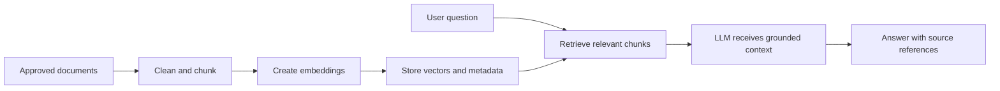

# 04 — Retrieval-Augmented Generation (RAG)


## Why RAG?
An LLM may not know private runbooks or current procedures. RAG retrieves relevant approved documents and supplies them as context. Retrieval does not guarantee correctness; evaluate relevance and cite sources.

## RAG pipeline
1. Ingest trusted documents.
2. Clean and split text into chunks.
3. Create embeddings.
4. Store vectors and metadata.
5. Retrieve relevant chunks for a query.
6. Give retrieved context to an LLM.
7. Return an answer with source references and uncertainty.

## Starter: keyword retrieval
The existing `rag_agent.py` is a tiny keyword lookup, not full vector RAG.

```python
docs = [
    {"id": "RUNBOOK-1", "text": "For timeout, check network path and server health."},
    {"id": "RUNBOOK-2", "text": "For null pointer, check variable initialization."},
]
query = "Jenkins connection timeout".lower()
matches = [doc for doc in docs if "timeout" in query and "timeout" in doc["text"].lower()]
print(matches[0]["id"] if matches else "No match")
```
Output: `RUNBOOK-1`.

## Retrieval quality and safety
Use approved, versioned runbooks; store source metadata; evaluate relevance; treat retrieved documents as data rather than higher-priority instructions; never index secrets. If no reliable source is retrieved, say so.

## Next implementation
Later add a chunker, embedding model, vector database, and LLM call. This starter does not claim that vector RAG is implemented.

## Exercises
Return runbook IDs, handle ambiguous matches, chunk a longer document, and create test questions with expected sources.

## Interview questions
What are embeddings? Why chunk documents? RAG versus fine-tuning? How do you evaluate retrieval? How do you defend against prompt injection in retrieved documents?

## Additional example: retrieval with metadata filters

Run from the repository root:

```powershell
python .\04-rag\metadata_filter_retrieval.py
```

Linux:

```bash
python ./04-rag/metadata_filter_retrieval.py
```

Expected output:

```text
RB-101 (approved=True): Check DNS, network path, and upstream health.
```

The example filters out unapproved documents and documents for other services before keyword matching. This is still simple tag/keyword retrieval, not embedding-based vector search.

[Open the example code](metadata_filter_retrieval.py).

## Visual: RAG pipeline

The current starter demonstrates keyword retrieval; embeddings and vector storage are roadmap concepts, not yet implemented here.


