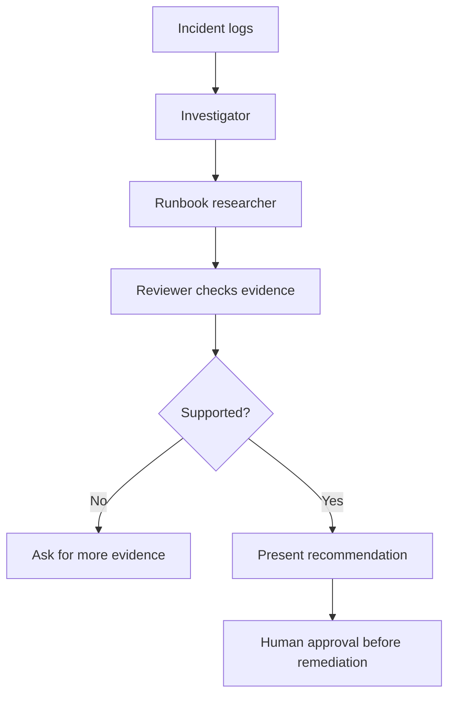

# 06 — Multi-Agent Systems

## Concept
A multi-agent workflow separates roles such as investigator, runbook researcher, and reviewer. Real agents may use LLMs and tools; separate Python functions are only a simulation of role separation.

## Example workflow
1. Investigator extracts evidence.
2. Runbook researcher finds a known procedure.
3. Reviewer checks that the recommendation is supported.
4. Orchestrator presents findings and asks for approval before changes.

Run `python multi_agent.py` from the repository root. The current code is deterministic and does not call an external model.

Expected output:
```text
Investigation: Likely network or server timeout.
Recommendation: Check network path and server health.
Status: Approval required before any remediation.
```

## Trade-offs and failure handling
Multiple agents add latency, cost, coordination, and failure modes. Use them only when separation helps. Define shared state, timeouts, step limits, and a stop condition. Preserve tool errors, limit retries, and reconcile conflicting findings using evidence.

## Exercises
Add a researcher role; reject unsupported recommendations; limit handoffs; test conflicting findings.

## Interview questions
When do multi-agent systems help? How is state shared? How do you prevent loops? What are latency and cost trade-offs?

## Additional example: multi-agent pipeline with unknown cases

Run from the repository root:

```powershell
python .\06-multi-agent-systems\multi_agent_pipeline_example.py
```

Linux:

```bash
python ./06-multi-agent-systems/multi_agent_pipeline_example.py
```

The script prints three triage dictionaries: timeout, disk-full, and unknown error. Each result includes evidence, a recommendation, a confidence note, and `approval_required: True`. The unknown case explicitly notes insufficient evidence. These are Python functions simulating specialist roles, not independent LLM agents.

[Open the example code](multi_agent_pipeline_example.py).

## Visual: specialist roles and review

Specialist roles separate responsibilities; the code in this folder simulates the roles with deterministic functions.


