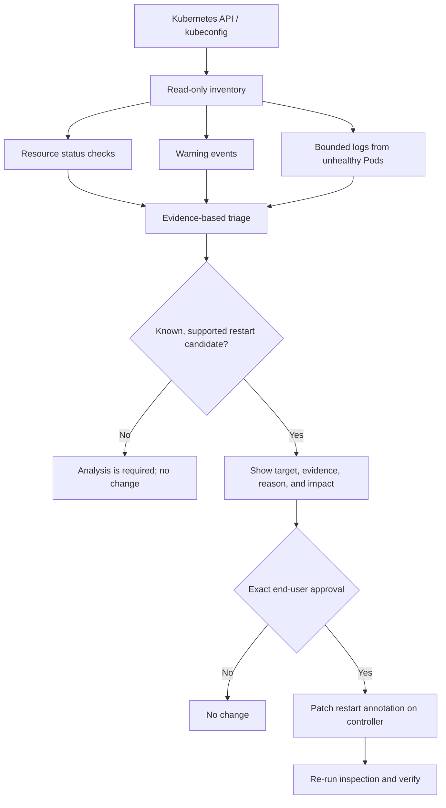

# 08 — K-Agent: Kubernetes Health & Troubleshooting Agent


K-Agent is a learning project for inspecting Kubernetes health, analyzing warning events and Pod logs, explaining likely causes, and proposing a limited remediation only after explicit user approval.

**Default mode is read-only.** It never automatically changes a cluster. A restart is only offered for a narrow set of recognized controller failure signals and only after an exact approval phrase. Unknown cases return: **“Analysis is required: the agent has no safe, evidence-backed known solution.”**

> This is a conservative educational assistant, not a production-grade Kubernetes operator or a guarantee that every cluster failure can be repaired automatically. Start in a disposable development cluster.

## Learning objectives

- Check the current health of Kubernetes resources.
- Inspect Pods, Deployments, StatefulSets, DaemonSets, ReplicaSets, Jobs, CronJobs, Services, Endpoints, Nodes, Namespaces, PVCs/PVs, Ingresses, NetworkPolicies, HPAs, PDBs, RBAC metadata, storage resources, and CRD definitions.
- Read bounded logs from unhealthy Pods and surface Warning events.
- Distinguish evidence from likely explanations.
- Use a small, explicit known-remediation catalog.
- Ask for exact end-user approval before a supported rollout restart.
- Keep unknown errors in investigation mode.

## Architecture



## What the first version inspects

| Area | Checks in this version |
|---|---|
| Workloads | Pod phase/container states/restarts; Deployment, StatefulSet, and DaemonSet readiness; ReplicaSet inventory; Job completion/failure; suspended CronJobs are surfaced as informational |
| Service networking | Service inventory; selector-based Services with no ready Endpoints; Ingress and NetworkPolicy inventory |
| Cluster | Node Ready conditions; Namespace phase; cluster-scoped resources inventory |
| Storage | PVC binding state; PV and StorageClass inventory; CSI driver inventory |
| Configuration and identity | ConfigMap, ServiceAccount, Secret **metadata only**, ResourceQuota, LimitRange, Role/RoleBinding/ClusterRole/ClusterRoleBinding inventory |
| Scaling and disruption | HPA and PodDisruptionBudget inventory |
| Events and logs | Warning Events; last 80 lines of current or previous container logs where available, clipped before display |
| Extensions | CRD definitions and Established condition |

Kubernetes has a large, extensible API. This first version inventories common built-in resource families and CRD definitions, but **does not automatically understand every third-party custom-resource instance**. Custom resources have domain-specific schemas and health semantics; add explicit adapters for the CRDs installed in your environment. Resources that the current identity cannot read may appear as warnings or incomplete inventory.

## Setup

Python 3.10+ is recommended. First follow [Environment Setup](../00-environment-setup/README.md), activate the repository virtual environment, and configure a Kubernetes context.

Install the dependency:

```powershell
python -m pip install -r .\\08-k-agent\\requirements.txt
```

Linux:

```bash
python -m pip install -r ./08-k-agent/requirements.txt
```

Check that the intended cluster/context is selected before running K-Agent:

```bash
kubectl config current-context
kubectl get nodes
```

The agent uses the normal kubeconfig context. It does not switch contexts or create credentials for you.

## Run examples

### 1. Read-only snapshot for one namespace

```powershell
python .\\08-k-agent\\k_agent.py --namespace default
```

Linux:

```bash
python ./08-k-agent/k_agent.py --namespace default
```

### 2. Inspect all namespaces

```bash
python ./08-k-agent/k_agent.py --all-namespaces
```

### 3. Poll every 30 seconds

```bash
python ./08-k-agent/k_agent.py --all-namespaces --watch --interval 30
```

This is polling, not a Kubernetes watch stream. It reports a snapshot each interval and may not see short-lived issues between polls.

### 4. Emit JSON for a future dashboard or pipeline

```bash
python ./08-k-agent/k_agent.py --namespace default --json
```

### 5. Offer approval-gated restarts

```bash
python ./08-k-agent/k_agent.py --namespace staging --approve-restarts
```

The program prints the exact workload, observed reason, evidence, rationale, and impact warning. It proceeds only if the user types the exact phrase, such as:

```text
APPROVE Deployment/payments-api in staging
```

Any other input, end-of-file, or interrupt means **no change**. The current implementation supports a rollout restart only for Deployment, StatefulSet, and DaemonSet by adding the standard `kubectl.kubernetes.io/restartedAt` Pod-template annotation. It does not delete Pods or patch Services, Nodes, PVCs, CRDs, or RBAC.

A rollout restart can disrupt workloads and is **not a universal fix**. Review logs and events first. An approval prompt in a CLI is a learning safeguard, not a complete enterprise authorization/audit system. For production, add authenticated identity, RBAC, durable audit records, change windows, policy checks, and a separate approval service.

## How diagnosis works

1. Read the current status and desired/ready counts.
2. Collect Warning events from the Kubernetes Events API.
3. For unhealthy Pods, try to read bounded container logs; use previous logs for common crash-loop states when available.
4. Map recognizable signals to cautious next steps:
   - `ImagePullBackOff` / `ErrImagePull`: inspect image/tag, registry access, and image pull secrets; do not restart automatically.
   - `OOMKilled`: inspect memory usage and limits; do not restart automatically.
   - `Pending`: inspect scheduling events, capacity, affinity/taints, and PVC binding; do not restart automatically.
   - `CrashLoopBackOff` / `Error`: review logs and events; a controller rollout restart may be offered as a transient-failure attempt, but it may not resolve a code/configuration issue.
   - Unknown reasons: display **analysis required** and do not offer a remediation.
5. If a supported controller restart is proposed, show why and ask for exact approval.
6. Re-run K-Agent to verify current state; the restart API response alone is not proof that the workload recovered.

## Tests (no cluster required)

The unit tests exercise pure classification and recommendation logic with synthetic Kubernetes-style objects.

From repository root:

```powershell
python -m unittest discover -s .\\08-k-agent -v
```

Linux:

```bash
python -m unittest discover -s ./08-k-agent -v
```

Expected test summary: **8 tests pass**. These tests do not validate connectivity, permissions, or behavior against a live cluster. Run an additional smoke test in a disposable cluster before trusting the integration.

## Least-privilege permissions

For inspection, grant only the `get`, `list`, and where needed `watch` permissions on the resource types you intend to inspect. Pod logs require `get` on `pods/log`. The optional restart feature needs `patch` on Deployments, StatefulSets, and DaemonSets in the intended namespaces. Do not give the agent cluster-admin just to make permission errors disappear. Scope permissions per namespace where possible.

The script prints warnings when reads fail, but a missing permission means the report may be incomplete. It must never interpret “could not read” as “healthy.”

## Known limitations and next steps

- This version uses deterministic rules, not an LLM. It does not invent fixes for unknown failures.
- It does not automatically inspect application-specific custom resources or every API group in a cluster.
- It does not run shell commands, exec into containers, edit manifests, scale workloads, change resource limits, delete resources, or alter Service/Ingress/CRD configuration.
- A controller restart is the only implemented mutation and requires explicit exact-text approval.
- There is no durable audit store, approval identity verification, metrics backend, or production-grade event stream yet.
- API discovery errors and insufficient RBAC can result in partial results; read the warnings.

Potential next stages: add a dynamic API discovery adapter for selected CRDs; create a read-only event/log timeline; add integration tests against a disposable kind/minikube cluster; store audit records; then integrate an approved LLM/RAG runbook layer. Keep approval outside the LLM and enforce it in code.

## Interview questions

1. Why is `Running` not the same as application health?
2. How would you distinguish `Pending`, `ImagePullBackOff`, `CrashLoopBackOff`, and `OOMKilled`?
3. Why inspect Events and previous container logs?
4. Why does a Service with no ready Endpoints often point to a selector/readiness problem?
5. Why is CRD definition inventory different from understanding custom-resource health?
6. Why must a restart require approval and a follow-up health check?
7. How should the agent behave when it cannot read a resource because of RBAC?
8. Why is a deterministic troubleshooting script not yet an LLM-powered agent?
