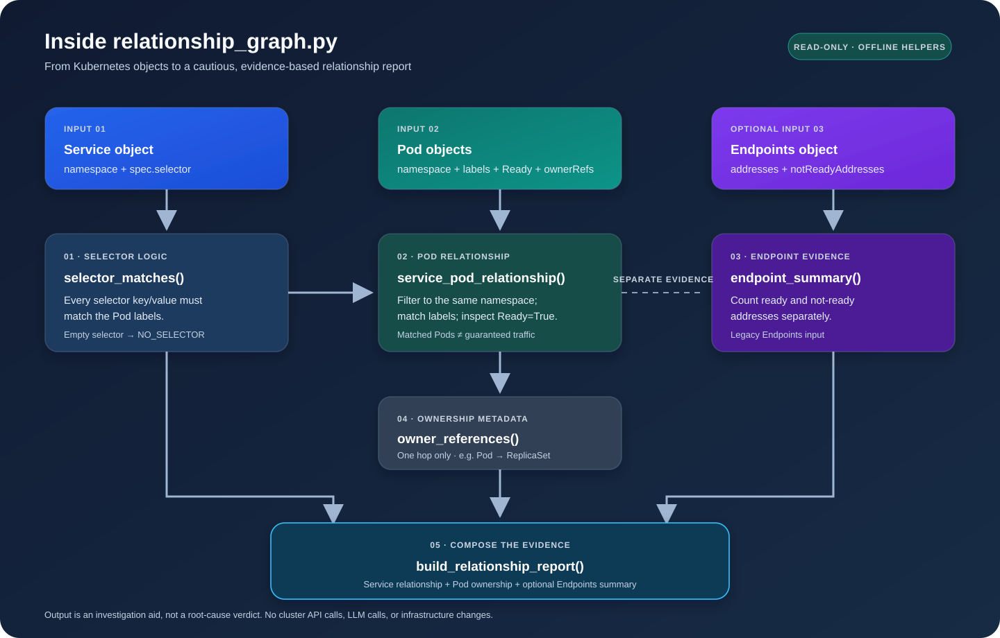

# K-Agent v2 relationship graph — code walkthrough

## The problem in plain English

A Pod can be Running while a Service still has no useful backends. To investigate that gap, collect several separate facts:

1. What label selector does the Service declare?
2. Which Pods in the same namespace have every selector label?
3. Which matched Pods report a Ready condition?
4. What addresses does the Endpoints object currently publish?
5. What owner reference does each matched Pod declare?

These are evidence points. They are not proof that a request can reach the application or that a particular component caused the incident.

## Main functions

### `selector_matches(selector, labels)`

The function checks every key/value pair in the Service selector. The `all(...)` expression returns True only if every requested label exists with the expected value. An empty selector deliberately returns False: silently matching every Pod would create a misleading report.

### `service_pod_relationship(service, pods)`

The function first reads the Service namespace and selector. It filters out Pods from other namespaces, then applies the selector check to each remaining Pod. It separately reads Pod conditions and adds a Pod to `ready_pods` only when a Ready condition has status True.

The resulting `diagnosis` is a small evidence classification:
- `NO_SELECTOR`: no selector was supplied.
- `NO_MATCHING_PODS`: selector exists but no supplied Pod matches.
- `MATCHED_PODS_NOT_READY`: Pods match, but none reports Ready.
- `READY_PODS_MATCH`: at least one matching Pod reports Ready.

This is intentionally conservative. The helper does not query the cluster and does not claim that a ready Pod is serving successful requests.

### `endpoint_summary(endpoints)`

Kubernetes Endpoints separates addresses into ready `addresses` and `notReadyAddresses`. The helper counts and names both groups. It supports target references when present and falls back to the IP address when no target name is available.

### `owner_references(pod)`

A Pod's ownerReferences may identify a ReplicaSet. The helper returns the declared reference, including kind, name, UID, and controller flag. It does not fetch that ReplicaSet or continue upward to a Deployment. That requires another API read and UID validation.

### `build_relationship_report(...)`

This composes the smaller helpers into one report. Keeping the functions separate makes the logic easy to test and later connect to a Kubernetes API adapter. Optional Endpoints evidence is included only when supplied.

## Run the synthetic demo

From the repository root:

```bash
python 08-k-agent/relationship_demo.py
python -m unittest discover -s 08-k-agent -v
```

The demo uses fabricated Kubernetes-shaped dictionaries. It requires no cluster, kubeconfig, or external dependency. The test suite checks selector matching, namespace isolation, readiness, empty selectors, endpoint counts, and owner references.

## Production integration sequence

1. Read Services, Pods, and Endpoints with a least-privilege Kubernetes identity.
2. For clusters using EndpointSlices, add an EndpointSlice adapter; do not assume legacy Endpoints is the only source.
3. Resolve owner references by kind, namespace, name, and UID; validate UIDs before following the chain.
4. Add timestamps and Warning Events to build an incident timeline.
5. Preserve the original evidence and distinguish it from hypotheses.
6. Keep all mutations behind an external authenticated approval and policy gate.

**Not implemented here:** live API collection, EndpointSlice support, full owner-chain traversal, timestamp correlation, LLM reasoning, automated remediation, or production audit storage. The code is a focused offline teaching component, not a finished root-cause engine.


## Architecture diagram



Read the diagram from top to bottom: three input object types feed separate evidence helpers; Service selector matching and Pod readiness analysis are distinct from optional Endpoints summarization; Pod owner references are extracted as one-hop metadata; finally, `build_relationship_report()` composes the evidence. The diagram deliberately labels the output as an investigation aid, not a definitive root-cause result.
