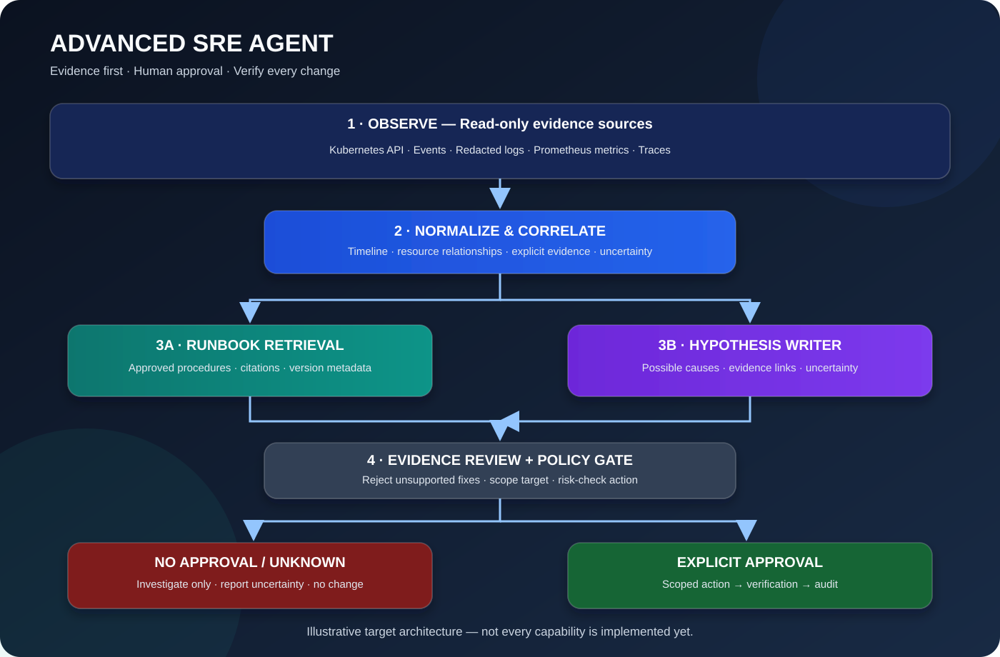

# 09 — Advanced SRE Agent: From Alerts to Evidence-Based Incident Response

> Goal: evolve K-Agent from a resource checker into a careful incident-investigation assistant that correlates evidence, explains uncertainty, consults runbooks, and proposes controlled actions.

This module contains a roadmap and a small, runnable **offline correlation prototype**. It does not connect to a cluster, call an LLM, or change infrastructure. Learn and test decision logic before adding privileged integrations. For a plain-English, line-by-line explanation, open the [Code Walkthrough](CODE_WALKTHROUGH.md).

## Advanced capabilities roadmap

| Capability | What it adds | Safety rule |
|---|---|---|
| Cross-resource correlation | Relates unhealthy Pods, workload readiness, and Service endpoint symptoms | Evidence is not proof of causation |
| Incident timeline | Orders events and logs around an incident window | Preserve timestamps and source labels |
| Runbook retrieval (RAG) | Retrieves approved procedures for similar symptoms | Cite the runbook; never invent steps |
| Metrics-aware diagnosis | Adds CPU, memory, latency, and saturation signals | Include source and measurement window |
| LLM explanation layer | Summarizes evidence and proposes hypotheses | Treat model output as untrusted |
| Approval-gated remediation | Proposes a minimal, scoped change | Enforce approval in code, outside the LLM |
| Post-change verification | Checks whether symptoms improved | API acceptance is not proof of recovery |
| Audit and policy controls | Records actor, evidence, approval, action, and result | Least privilege and durable audit |
| Multi-cluster / CRD adapters | Supports multiple contexts and selected custom resources | Explicit allowlists and per-cluster permissions |
| ChatOps incident report | Publishes a concise report to an approved channel | Never expose secrets in chat |

## Architecture

~~~mermaid
flowchart TD
    A[Metrics, Events, Logs, Kubernetes API] --> B[Evidence Collector]
    B --> C[Normalize, redact, timestamp]
    C --> D[Incident Correlator]
    D --> E[Runbook Retrieval]
    D --> F[LLM Hypothesis Writer]
    E --> G[Evidence Reviewer]
    F --> G
    G --> H{Known, supported, low-risk action?}
    H -- No --> I[Investigation required; no change]
    H -- Yes --> J[Human approval and policy check]
    J -- Denied --> K[Record decision; no change]
    J -- Approved --> L[Execute scoped action]
    L --> M[Verify health and compare metrics]
    M --> N[Audit result and incident report]
~~~

## First runnable example: correlate evidence

### Plain-English logic

1. Receive normalized findings from independent read-only checks.
2. Group findings by namespace and workload name.
3. Detect a relationship, such as an unhealthy Deployment and a Service with no ready endpoints.
4. Return the evidence behind the relationship.
5. Label the result a **hypothesis**, not a guaranteed root cause.

Run from the repository root:

~~~bash
python 09-advanced-sre-agent/incident_correlator.py
~~~

Expected output:

~~~text
Incident: checkout-api in namespace production
Severity: HIGH
Hypothesis: Workload readiness and Service endpoint symptoms may be related; this correlation does not prove root cause.
Evidence:
  - Deployment/checkout-api: 1/3 replicas ready
  - Service/checkout-api: no ready endpoints
Next checks:
  - Inspect Pods owned by the workload and their Warning events.
  - Check readiness probes, selector labels, and recent rollout history.
  - Compare application errors and latency in the same time window.
Decision: INVESTIGATE_ONLY (no infrastructure changes performed)
~~~

## Example evidence contract

~~~python
finding = {
    "source": "kubernetes",
    "timestamp": "2026-10-27T10:15:00Z",
    "namespace": "production",
    "kind": "Deployment",
    "name": "checkout-api",
    "status": "ISSUE",
    "observation": "1/3 replicas ready",
    "confidence": 0.95,  # confidence in the observation, not root cause
}
~~~

Do not confuse confidence in a measurement with confidence in its cause. “1/3 replicas ready” is observable evidence; “bad deployment caused the outage” is a hypothesis that needs more evidence.

## Suggested implementation sequence

1. **Evidence model:** standardize source, timestamp, namespace, resource, observation, confidence, and redaction status.
2. **Correlation:** connect workload, Pod, Service, event, and metric findings with explicit time windows.
3. **Runbook RAG:** index approved runbooks with service, cluster, environment, and version metadata.
4. **Reviewer:** require each hypothesis to reference evidence; reject unsupported claims.
5. **Approval service:** authenticated approver, explicit target/action, expiry, and policy validation.
6. **Remediation adapter:** allowlisted actions only; dry-run where supported; no arbitrary shell.
7. **Verification:** check readiness, error rate, latency, and relevant SLOs before declaring recovery.
8. **Audit:** record evidence, recommendation, approver, action, timestamps, and result.
9. **Observability:** expose agent metrics, traces, structured logs, and failure alerts.
10. **Integration tests:** use kind or Minikube with seeded failures before any shared cluster.

## Security checklist

- [ ] Read-only credentials for investigation; separate credentials for approved actions.
- [ ] No cluster-admin by default; namespace-scoped RBAC where practical.
- [ ] Logs and prompts are redacted; secrets are never sent to external models.
- [ ] Tool arguments are schema-validated and target-allowlisted.
- [ ] Approval is authenticated, action-specific, time-bound, and recorded.
- [ ] A dry-run and risk policy run before a mutation.
- [ ] Post-action verification is required; API acceptance is not recovery.
- [ ] Unknown or conflicting evidence leads to investigation, not guessed remediation.
- [ ] Integration tests use a disposable cluster and synthetic workloads.
- [ ] Incomplete permissions and agent failures are visible in the report.

## Tests

~~~bash
python -m unittest discover -s 09-advanced-sre-agent -v
~~~

Tests use synthetic findings and do not require Kubernetes credentials.

## Honest project status

This is an educational prototype. The correlator uses sample normalized findings only. Metrics ingestion, event streaming, production RAG, LLM reasoning, multi-cluster access, authenticated approvals, durable auditing, and automated rollback are **future work**, not implemented features. Do not connect an experimental remediation agent to production without security review and staged integration tests.

## Interview practice

1. Why is correlation different from root-cause proof?
2. How would you prevent an LLM from executing a command it invented?
3. Why should approval be enforced outside the model?
4. What evidence proves a remediation worked?
5. How do you prevent secrets in logs from entering prompts?
6. How would you handle contradictory metrics and Kubernetes events?
7. How can custom resources be supported without assuming they share health semantics?
