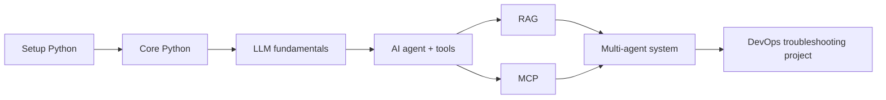
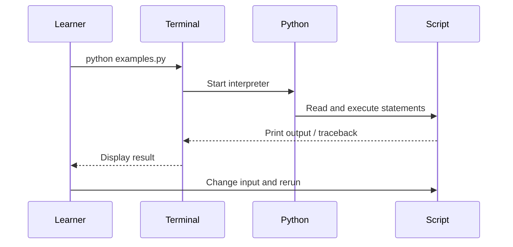

# Screenshots, diagrams, and visual learning guide

This repository uses **Mermaid diagrams** because GitHub renders them directly in Markdown. They are source-controlled, readable, and can be updated alongside the code.

## 1. The learning journey

## 2. What happens when a learner runs a script?

## 3. VS Code setup screenshot checklist

Screenshots should show the actual local environment, not a fabricated UI. Capture these on the machine where the learner is installing the project and save them under `docs/images/`:

1. **01-python-version.png** — terminal showing `python --version` and `git --version`.
2. **02-venv-activated.png** — terminal prompt showing the activated `.venv` environment and `python -c "import sys; print(sys.executable)"`.
3. **03-vscode-interpreter.png** — VS Code interpreter selector with this repository's `.venv` interpreter selected. Hide personal paths if desired.
4. **04-run-example.png** — VS Code terminal running `python .\01-python-fundamentals\examples.py` (Windows) or `python ./01-python-fundamentals/examples.py` (Linux), with output visible.
5. **05-tests-passed.png** — terminal showing the unit-test command and passing test summary.

### Capture and add the screenshots

1. Run the command shown for that screenshot.
2. Make sure no tokens, passwords, personal account details, or production data appear in the frame.
3. Take a screenshot using your operating system's screenshot tool.
4. Save the image with the exact filename above inside `docs/images/`.
5. Add it to this document using Markdown, for example: ``.
6. Commit the image and updated Markdown file to GitHub.

**Important:** Screenshots depend on the learner's actual OS, Python version, and VS Code setup. This guide deliberately does not pretend that screenshots were captured on the learner's computer. The diagrams above are rendered from Mermaid source and are not screenshots.
